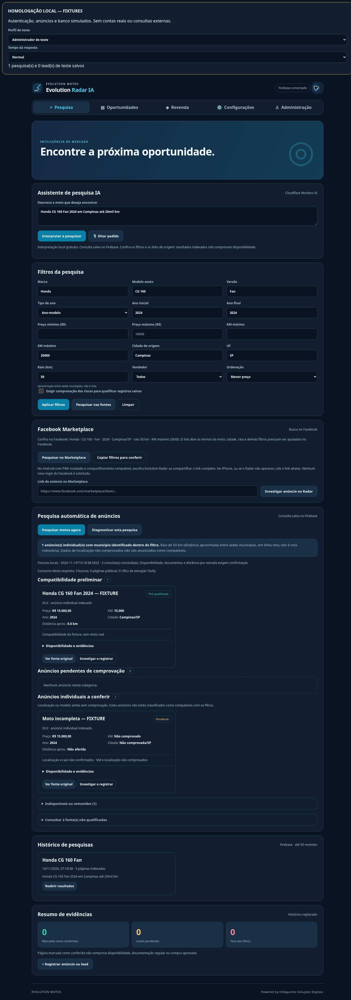

# Validação executada e limites

Conferência concluída em 14/11/2026. Base anterior: 116/116 testes aprovados.

| Verificação executada | Resultado | Escopo |
|---|---|---|
| `npm run check` | **165 testes, 165 aprovados, 0 falhas** | Sintaxe, Worker gerado equivalente, regras de negócio, interpretação, pesquisa com mocks, fontes, riscos, geografia, autenticação de Worker, permissões e Service Worker |
| Regras + APIs no emulador | **17 testes, 17 aprovados, 0 falhas** | Leitura privada, solicitação/aprovação, criação/edição/arquivamento, suspensão/revogação, histórico com autor/timestamp e trilha de risco |
| Referências/imports locais e arquivos do cache | Nenhum recurso ausente | Conferência de arquivos reais e manifesto; ícones PNG derivados do SVG original |
| `git diff --check` | Sem erros | Espaçamento/diff |
| Navegador Chrome local com fixtures | Fluxos abaixo conferidos | Aplicativo real copiado; transportes substituídos somente na cópia de QA |

Os 49 testes adicionais da suíte geral cobrem as falhas novas e seus limites. Testes antigos foram ajustados quando pressupunham que só extração/índice bastava para pré-qualificação ou confundiam distância de rota com raio municipal; a evidência pública agora é exigida. Nenhum teste foi removido para ocultar falhas.

## Integração isolada

Uma reexecução via Firebase CLI foi bloqueada pela revisão automática por possível requisição a host público. A validação final usou o JAR oficial do Database Emulator já instalado, vinculado explicitamente a `127.0.0.1:19000`, e os testes Node no mesmo processo de execução. Nenhuma chamada pública substituiu o emulador. Os dois arquivos de integração agora recusam execução sem `FIREBASE_DATABASE_EMULATOR_HOST` explicitamente em `127.0.0.1` ou `localhost`, e passam host/porta ao ambiente de teste.

O teste adicional detectou inicialmente uma duplicação de trilha após serialização pelo RTDB: ordem das propriedades e representação da data alteravam uma comparação textual. A implementação foi corrigida para comparar relatórios normalizados dentro da transação. A repetição final comprovou uma revisão inicial, nenhuma revisão duplicada ao editar somente observações, e uma segunda revisão ao alterar o estado, conservando autor e antes/depois.

## Casos de interpretação

- As duas frases F12 (`Honda Fan 160 2024 em Campinas até 20 mil km` e `Honda CG 160 Fan 2024 em Campinas até 20mil km`) produziram CG 160 / Fan, ano-modelo 2024, Campinas/SP, KM máximo 20000 e preço máximo vazio na tela e nos testes.
- Preço explícito de R$ 18.000, KM entre 10 e 20 mil e raio 50 km: unidades separadas.
- Suzuki DR160 2026, Ribeirão Preto/SP, raio 10, preço 19000–23000: campos exatos; limite antigo de KM limpo.
- Yamaha Factor 125 2012, São José do Rio Preto/SP, raio 50: marca/modelo/versão/anos/localização corretos; sem novo limite de preço inventado.
- Alteração parcial para Campinas, R$ 9 mil e 25 mil KM: modelo e ano apropriados mantidos; cidade e limites substituídos.
- Faixas invertidas, versões conflitantes, múltiplas cidades e valores ambíguos interrompem a pesquisa. Valor com unidade não vira ano/cilindrada; cidade com nome de cor e `se possível` não viram filtros falsos.

## Pesquisa e falhas exercitadas

Fixtures cobrem JSON-LD primário completo, ItemList/ID diferente ignorados, HTML + extração contraditórios, dois objetos primários contraditórios, resposta parcial Tavily, limite 429, timeout, redirecionamento não seguido, link não permitido, campo ausente, deduplicação, orçamento, recuperação regional, anúncio removido e recomendações em soft-404. Distância de entrega/raio textual não é KM do hodômetro. Índice sem identidade comprovada na página fica pendente.

O contrato autenticado do Worker comprovou cache com nova autenticação, revogação impedindo acesso a cache, consultas simultâneas com uma só coleta, sétima coleta distinta recusada no orçamento temporário, corpo grande sem Content-Length recusado e município inválido sem consumo Tavily. Todos os transportes eram mocks.

## Interface observada

| Fluxo | Evidência observada |
|---|---|
| Filtros e pesquisa/histórico | Campos finais acima, categorias de fixtures distintas e histórico registrado no fluxo existente |
| Risco | Sem fonte/protocolo/data/escopo, salvamento bloqueado com aviso dentro do diálogo; preenchimento de fixture levou a registro “Eliminada” |
| Facebook manual | URL móvel com rastreador normalizada; marca, modelo, versão, ano, preço, KM e cidade permanecem vazios no cadastro recebido |
| Recebimento compartilhado | Navegação ao receiver GET abriu pendência e revisão; não criou lead automaticamente; endereço de recebimento foi limpo |
| Permissão/suspensão | Perfil somente leitura recebeu bloqueio de pesquisa; suspensão durante resposta lenta não criou histórico de pesquisa |
| Revenda | Compra 13000, revenda 17000 e custos 500: total 13500 e resultado matemático 3500, com aviso de estimativa |
| Temas | Alternância claro/escuro conferida; retorno ao tema escuro |
| Desktop | Largura útil 1348 px, conteúdo 1348 px: sem overflow |

Em quadros de mesma origem no Chrome, as larguras solicitadas de **320/390/768/1024 px** produziram larguras úteis de **301/371/749/1005 px**, respectivamente (bordas e barra vertical do quadro descontadas), sem conteúdo horizontal excedente. Pesquisa foi medida nas quatro; revenda e configurações também em 768/1024. O diálogo de risco expandido teve conteúdo/largura **246/246** no quadro de 320 e **316/316** no de 390. Isso valida essas medidas no Chrome, não certifica Safari, orientação física ou um Android específico.

O preço máximo visual de exemplo no placeholder não é valor do formulário: a leitura do DOM confirmou `priceMax: ""`, `kmMax: "20000"`. A imagem tem faixa explícita de homologação e resultados de teste.

## O que não foi comprovado

Não houve pesquisa real de estoque de motos, inferência real de IA nesta candidata, conexão real a fornecedor veicular, leitura de sessão Facebook ou envio a vendedor. Aparição no seletor nativo de compartilhamento, abertura do aplicativo no telefone, atualização do PWA instalado e Safari/iPhone físico precisam de homologação autorizada.

A captura automática do evento de download no iframe não terminou no navegador remoto; não é reportada como exportação validada de ponta a ponta. Sanitização, CSV protegido e round-trip JSON dos campos novos passaram nos testes; download/importação no aparelho permanece no roteiro de homologação. Disponibilidade de venda e documentos exigem confirmação atual na fonte. Zero qualificados não significa ausência de motos.

## Revisão adicional do Codex — 14/11/2026

O PR #17 recebeu dois apontamentos P2 depois da primeira validação de 161 testes. As correções foram feitas **somente na branch de homologação**, com quatro testes novos (total 165):

- **Modelo desconhecido versus filtros salvos**: "Honda XRE 300 2020 em Campinas" depois de uma Honda CG 160 Fan não usa mais a CG salva como se o pedido tivesse sido compreendido localmente. A regra também cobre "XRE 300" sem marca, preservando alterações parciais como "Honda em Campinas". Se a IA responder com modelo que contradiz o nome explícito, a pesquisa é bloqueada para esclarecimento.
- **Faixas abertas de ano**: "a partir de/desde 2020" mantém `yearFrom=2020` e `yearTo` vazio; "até 2022" mantém somente `yearTo=2022`; "ano 2020" permanece exato. A rota remota não deve impor um ano final que o pedido não forneceu.

Os testes `npm run check` no commit `8f178d72d52e996e5f242e0d92dd09d213c2a0ac` concluíram 165/165; os checks GitHub de segurança foram aprovados. Os testes em navegador físico e com anúncios reais continuam pendentes como descrito acima. Nenhum merge/publicação foi feito.
